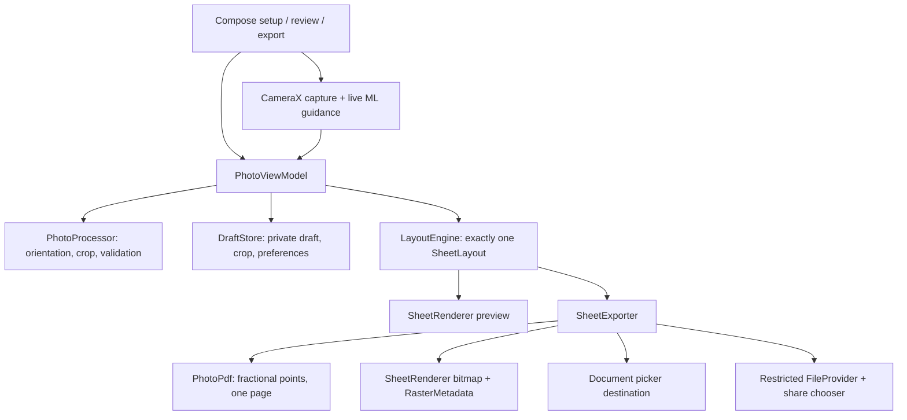

# Architecture — 0.2.0

The existing two-module architecture is preserved: a Kotlin-only `core` module and one native Android `app` module. No server or network processing was added.

## One-page contract

`SheetConfig.copies == null` is Maximum. Orientation is AUTO, PORTRAIT or LANDSCAPE. Grid analysis calculates both orientations with identical configured gaps/margins; ties favor portrait. Capacity is the product of the integer column and row counts. The grid is uniform, upright and practical for straight cuts; it does not optimize mixed rotations.

`LayoutEngine.calculate` rejects no-fit and over-capacity configurations. It returns one placement list, not page chunks. `PhotoPdf` emits exactly one page; the raster exporter emits one bitmap. The ViewModel holds an overflow candidate separately from the accepted settings, so dismissing an overflow dialog never corrupts a valid preview. Selecting Use maximum applies that candidate with a dynamic maximum.

Dimensions are millimeters. A 1 mm inset reserves external cutting-mark stroke extents within safe margins. The used grid footprint is top-left aligned, without spreading gaps, stretching photos, or changing the finished dimensions. Full-grid occupied and remaining widths/heights are available for testing and future UI diagnostics.

## Rendering and file formats

Preview and raster export call the same `SheetRenderer.draw` with a different pixels-per-millimeter scale. PDF uses the identical placement/mark geometry, converted with `72 / 25.4`. Fractional MediaBox/transform coordinates avoid integer-point A4 rounding. PDF embeds one RGB JPEG shared across the page.

Optional border strokes are inset by half their 0.2-point width. Outside corner marks stop short of the photo edge. Neither modifies the finished photo geometry.

A4 raster dimensions are rounded to nearest pixel at 300 DPI: 2480 × 3508 portrait and the inverse landscape. Normal subpixel quantization remains; PDF is preferred for precise physical printing. JPEG JFIF density is 300 × 300 dots/inch. PNG pHYs density is 11811 × 11811 pixels/meter. Metadata is inserted into newly encoded files without decoding/re-encoding or loading a sheet-sized compressed byte array. PNG CRCs and image decode are tested independently.

## State, memory and failures

The ViewModel survives activity recreation and owns accepted layout, source, crop, prepared portrait, validation, screen and busy state. DraftStore persists photo/crop/settings for process restart. Exact custom dimensions are stored as decimal strings, preserving values such as 32.1 mm across reloads. Legacy 0.1 copy/orientation preferences migrate to Auto/Maximum.

Capture/import replaces the private working source and resets quantity to maximum, with 35 × 45 mm and default orientation/margins/gaps. Decode is capped at a 2400-pixel longest edge. Prepared portraits cap effective rasterization at source detail/300 DPI instead of allocating unnecessary upscaled pixels for large custom sizes. Operations are serialized by busy state; decode, render, validation and file IO use background dispatchers. Sheet export allocates one raster at a time and recycles it in finally. Temporary encoding files are cleaned on failure; interrupted capture/encoding files are cleared on initialization.

Save uses user-selected document-provider URIs. Share uses unique files in the exports cache directory and read-only temporary grants. FileProvider exposes only that directory, not private source photos. Old share files are cleaned after 24 hours on initialization/new share, and explicit photo deletion removes current share-cache files. Recipient-owned copies and user-saved exports are outside app deletion control.

## Validation

Face bounds are not a crown-to-chin measurement. ML Kit face/pose/eye checks and image exposure/Laplacian/brightness/corner heuristics provide operator guidance, never official acceptance. Thresholds are intentionally visible as PASS/REVIEW/UNKNOWN. Heuristics require real portrait calibration before any stronger claims. A missing/failed detector falls back to manual review without blocking core crop/export.

## Later-phase seams

- **Direct printing:** Add an Android PrintDocumentAdapter over the same immutable layout/export path. Read printer media/non-printable margins, request recalculation if capacity changes, and require operator confirmation of reduced quantity. Never fit-to-page scale photos. Preserve the one-page contract.
- **Background replacement:** Add an opt-in processor before crop rendering, with original/reset paths and preset-specific allowed-edit policies. Do not alter face or identity features. Measure edge quality, especially hair, before release.
- **Multiple customers:** Extend placement records with a photo asset key and per-customer copy request. Render from an asset map and reject combined overflow within the same one-sided A4 constraint. Keep each customer's edits/retention separate. PDF can extend its single JPEG resource to a keyed XObject map.

These seams are documented only; no later-phase feature is exposed as if implemented.

## Primary references

- [Android file sharing and temporary URI grants](https://developer.android.com/training/secure-file-sharing)
- [Bundled ML Kit face detection](https://developers.google.com/ml-kit/vision/face-detection/android)
- [Android PDF integer page-size API](https://developer.android.com/reference/android/graphics/pdf/PdfDocument.PageInfo.Builder)
- [PNG physical pixel density specification](https://www.w3.org/TR/png-3/)

## Background processing (0.3.0)

BackgroundProcessor uses bundled ML Kit segmentation-selfie 16.0.0-beta6 in SINGLE_IMAGE_MODE. A raw float confidence mask is cached for the source image and invalidated on import/rotation. Bilinear sampling maps each prepared portrait pixel through the crop into normalized mask coordinates. Soft foreground confidence blends source RGB with an opaque chosen background. Output size and sheet geometry are unchanged. The segmenter is closed after each inference.

PhotoViewModel validates the original rendered crop, prepares the optional composite, then commits the result and background preference. Failed inference leaves the prior selection and prepared image intact. Mask processing runs on Dispatchers.Default. DraftStore persists only the original working photo and selected RGB; masks are regenerated on reopening. The manifest still strips network permissions.

API reference: https://developers.google.com/ml-kit/vision/selfie-segmentation/android

## 0.5.0 layout and UI

SheetLayout columns/rows report used columns and rows; Grid retains full capacity. LayoutEngine starts placements at Grid.inset, preserving guide and printer margins for all export paths. New imports reset SheetConfig to defaults. Draft reopening retains that draft’s custom settings. Advanced UI is conditionally composed by CustomSection; the A4 preview has no nested gesture scroll containers and primary actions sit outside the main scrolling content.

## 0.6.0 backgrounds

JPEG is the initial save/share format. Background swatches include named colors, before/after comparison, a zoomable detail dialog, and an optional RGB mixer. EdgeMode is persisted with the draft. BackgroundProcessor refines uncertain raw model confidence through joint bilateral upsampling with source RGB guidance, limited to a 1024-pixel longest edge and a 5 × 5 mask neighborhood. Confident interior/background anchors remain unchanged. RGB-guided changes blend at 40% strength and are capped to ±0.12 confidence per pixel to avoid snapping to unrelated background objects. Natural/Clean/Soft alpha mappings control residue versus softness without changing face pixels in the fully opaque interior. Raw masks/refinement are reused for color changes; original prepared crop and source checks are reused until crop/size/source changes.

## 0.7.0 ear/edge repair

MaskStroke points are normalized to the original source. Radius is a fraction of its shorter dimension. MaskRepair draws continuous segments into a copy of the finished alpha, with an opaque interior and 20% feathered rim. Restore uses max(alpha, brush); Erase uses min(alpha, 1-brush), preserving stroke order. This override happens after edge-mode mapping, so Cleaner mode cannot remove a restored ear. No original pixels or cached base segmentation are changed.

The full-screen repair editor has brush/move modes, zoom, size, compare, undo, reset, cancel and apply. It previews on Dispatchers.Default after each completed stroke; only Apply commits to the ViewModel/DraftStore. RepairCodec bounds and validates persisted data. Normalized points rotate clockwise with the source, survive crop/size changes and reset with a new photo. The landscape editor uses an independent scrolling controls column beside the canvas.

## 0.8.0 two-photo sheets

Two lifecycle ViewModels use separate DraftStore slots/files/preferences. The primary draft owns the sheet mode and exports; the secondary draft owns independent photo edits. PhotoSlots validates the fixed 30-photo portrait A4 contract and maps placements 0–14 to the first image, 15–29 to the second. Preview, raster export and PDF share this mapping. PDF embeds two JPEG resources on one page. Single-image APIs delegate to list-based writers for compatibility.

## 0.9.0 framing and edge colors

FaceFraming is platform-independent crop geometry with FramingTarget and FaceAnchor inputs. Android PhotoProcessor supplies frontal eye landmarks and lower face contour; missing information uses a labelled box fallback. Crop constraints are reported, never padded with generated pixels. Targets persist in the same per-photo DraftStore. New PNG drafts avoid repeated lossy rotation/restoration; legacy JPEG drafts load and migrate on subsequent save.

BackgroundProcessor retains the source-coordinate cached mask and bounded RGB-guided refinement. At output resolution, small local searches provide conservative background/foreground anchor colors. EdgeColor gates color unmixing using contrast and compositing residual. Confident interiors and brush-overridden alpha skip correction. Segmentation confidence is not a calibrated matte, so ambiguous evidence is intentionally left unchanged. Source image dimensions are still capped at 2400 and refinement at 1024; output-sized buffers bound extra composition memory.

## 0.10.0 Smart A4 extension

HomeScreen chooses independent Passport and Smart ViewModels. SmartViewModel persists image IDs, original private source files, per-image size/copies/fit/rotation and sheet settings. SmartLayoutEngine operates solely on millimeter rectangles, preserves complete exact requests or ratio batches, and returns immutable placement records. SmartRenderer prepares only participating images and uses those records for previews and image export. SmartPdf builds matching transforms and delegates object/xref/page serialization to PhotoPdf.writePage; raster density tagging and sharing reuse RasterMetadata and SheetExporter. CameraScreen gains a default-on faceGuidance parameter; Smart explicitly disables it without changing passport callers.

## House scheme photo template (0.11.0)

Home routes to a separate HouseScreen / HouseViewModel. HouseLayout builds deterministic portrait A4 frames for one or two exact 6 × 4-inch copies, or three maximally sized 6:4 copies inside fixed printer margins and cutting gaps. SmartRenderer is reused for proportional Fit Inside rendering, preview, cutting outlines and 300 DPI JPEG export. The original source and preferences have their own private storage; passport and Smart state are unchanged. Batch save creates three distinct SAF documents and reports partial failure without overwriting previous exports.
