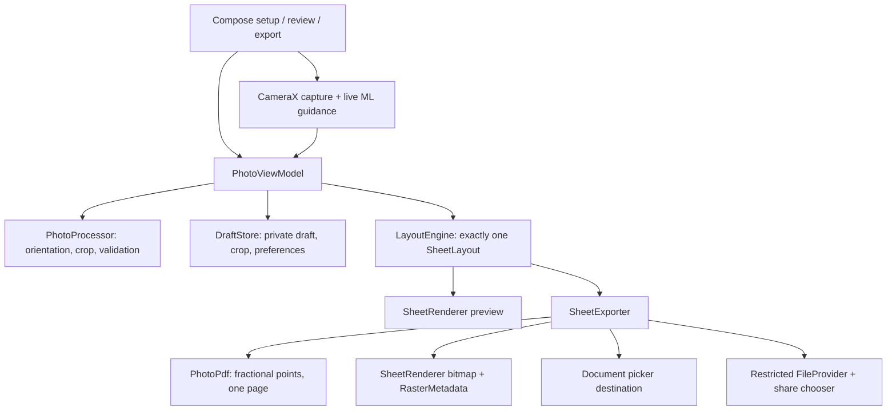

# Architecture — 0.2.0

The existing two-module architecture is preserved: a Kotlin-only `core` module and one native Android `app` module. No server or network processing was added.

## One-page contract

`SheetConfig.copies == null` is Maximum. Orientation is AUTO, PORTRAIT or LANDSCAPE. Grid analysis calculates both orientations with identical configured gaps/margins; ties favor portrait. Capacity is the product of the integer column and row counts. The grid is uniform, upright and practical for straight cuts; it does not optimize mixed rotations.

`LayoutEngine.calculate` rejects no-fit and over-capacity configurations. It returns one placement list, not page chunks. `PhotoPdf` emits exactly one page; the raster exporter emits one bitmap. The ViewModel holds an overflow candidate separately from the accepted settings, so dismissing an overflow dialog never corrupts a valid preview. Selecting Use maximum applies that candidate with a dynamic maximum.

Dimensions are millimeters. A 1 mm inset reserves external cutting-mark stroke extents within safe margins. The used grid footprint is centered, without spreading gaps, stretching photos, or changing the finished dimensions. Full-grid occupied and remaining widths/heights are available for testing and future UI diagnostics.

## Rendering and file formats

Preview and raster export call the same `SheetRenderer.draw` with a different pixels-per-millimeter scale. PDF uses the identical placement/mark geometry, converted with `72 / 25.4`. Fractional MediaBox/transform coordinates avoid integer-point A4 rounding. PDF embeds one RGB JPEG shared across the page.

Optional border strokes are inset by half their 0.2-point width. Outside corner marks stop short of the photo edge. Neither modifies the finished photo geometry.

A4 raster dimensions are rounded to nearest pixel at 300 DPI: 2480 × 3508 portrait and the inverse landscape. Normal subpixel quantization remains; PDF is preferred for precise physical printing. JPEG JFIF density is 300 × 300 dots/inch. PNG pHYs density is 11811 × 11811 pixels/meter. Metadata is inserted into newly encoded files without decoding/re-encoding or loading a sheet-sized compressed byte array. PNG CRCs and image decode are tested independently.

## State, memory and failures

The ViewModel survives activity recreation and owns accepted layout, source, crop, prepared portrait, validation, screen and busy state. DraftStore persists photo/crop/settings for process restart. Exact custom dimensions are stored as decimal strings, preserving values such as 32.1 mm across reloads. Legacy 0.1 copy/orientation preferences migrate to Auto/Maximum.

Capture/import replaces the private working source and resets quantity to maximum, while preserving explicit orientation preferences. Decode is capped at a 2400-pixel longest edge. Prepared portraits cap effective rasterization at source detail/300 DPI instead of allocating unnecessary upscaled pixels for large custom sizes. Operations are serialized by busy state; decode, render, validation and file IO use background dispatchers. Sheet export allocates one raster at a time and recycles it in finally. Temporary encoding files are cleaned on failure; interrupted capture/encoding files are cleared on initialization.

Save uses user-selected document-provider URIs. Share uses unique files in the exports cache directory and read-only temporary grants. FileProvider exposes only that directory, not private source photos. Old share files are cleaned after 24 hours on initialization/new share, and explicit photo deletion removes current share-cache files. Recipient-owned copies and user-saved exports are outside app deletion control.

## Validation

Face bounds are not a crown-to-chin measurement. ML Kit face/pose/eye checks and image exposure/Laplacian/brightness/corner heuristics provide operator guidance, never official acceptance. Thresholds are intentionally visible as PASS/REVIEW/UNKNOWN. Heuristics require real portrait calibration before any stronger claims. A missing/failed detector falls back to manual review without blocking core crop/export.

## Later-phase seams

- **Direct printing:** Add an Android PrintDocumentAdapter over the same immutable layout/export path. Read printer media/non-printable margins, request recalculation if capacity changes, and require operator confirmation of reduced quantity. Never fit-to-page scale photos. Preserve the one-page contract.
- **Background replacement:** Add an opt-in processor before crop rendering, with original/reset paths and preset-specific allowed-edit policies. Do not alter face or identity features. Measure edge quality, especially hair, before release.
- **Multiple customers:** Extend placement records with a photo asset key and per-customer copy request. Render from an asset map and reject combined overflow within the same one-sided A4 constraint. Keep each customer's edits/retention separate. PDF can extend its single JPEG resource to a keyed XObject map.

These seams are documented only; no later-phase feature is exposed as if implemented.

## Primary references

- [Android file sharing and temporary URI grants](https://developer.android.com/training/secure-file-sharing)
- [Bundled ML Kit face detection](https://developers.google.com/ml-kit/vision/face-detection/android)
- [Android PDF integer page-size API](https://developer.android.com/reference/android/graphics/pdf/PdfDocument.PageInfo.Builder)
- [PNG physical pixel density specification](https://www.w3.org/TR/png-3/)

## Background processing (0.3.0)

BackgroundProcessor uses bundled ML Kit segmentation-selfie 16.0.0-beta6 in SINGLE_IMAGE_MODE. A raw float confidence mask is cached for the source image and invalidated on import/rotation. Bilinear sampling maps each prepared portrait pixel through the crop into normalized mask coordinates. Soft foreground confidence blends source RGB with an opaque chosen background. Output size and sheet geometry are unchanged. The segmenter is closed after each inference.

PhotoViewModel validates the original rendered crop, prepares the optional composite, then commits the result and background preference. Failed inference leaves the prior selection and prepared image intact. Mask processing runs on Dispatchers.Default. DraftStore persists only the original working photo and selected RGB; masks are regenerated on reopening. The manifest still strips network permissions.

API reference: https://developers.google.com/ml-kit/vision/selfie-segmentation/android
