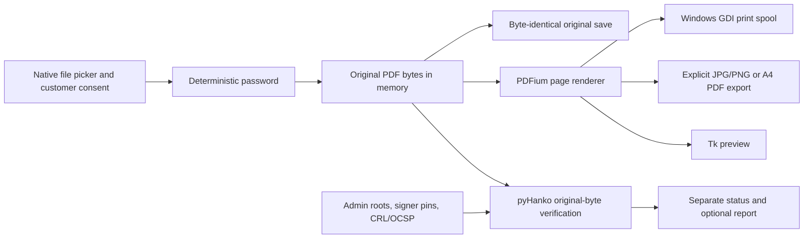

# Architecture and delivery phases

## Decision

Use a single-process desktop modular application: Python + standard Tkinter + PDFium through pypdfium2 + Pillow + pyHanko and its cryptography/certificate-validation dependencies. Use pywin32 only on Windows. No web server, browser engine, network listener, database or Adobe installation is required.

Tkinter is bundled with standard Windows Python and avoids a separate theming dependency. PDFium renders individual pages with a permissive open-source licensing route. PyMuPDF was considered but its AGPL/commercial licensing needs additional distribution decisions; pypdf and pikepdf are useful manipulation tools but are unnecessary when original-byte preservation and raster print copies meet the workflow. CustomTkinter can be added later without changing the verification engine. No dependency requires a paid runtime subscription, but redistribution still requires preserving applicable license notices.



All PDF work runs on one executor worker. PDFium is not generally thread-safe; tasks are serialized, PDF handles close while the worker is idle, and UI widgets update only on the Tk main thread through a result queue. Preview holds only one downscaled page. Export and print render pages sequentially, with file, page-dimension and raster-pixel bounds. A4 PDFs still accumulate compressed page images in their PDFium output document; memory/performance must be measured on the target PC. Optional print footers are added outside source page pixels and never written into the signed source.

Signature reading first uses strict PDF parsing. A strict-syntax rejection triggers one compatibility-mode retry on an independent stream of the identical original bytes. No file repair is attempted. Signature integrity and trust checks still run, but compatibility results are capped at yellow; detected invalidity remains red. The report exposes parser mode, a safe diagnostic code and a separate syntax warning. Generic parser failures and cryptographic failures are not reasons to retry.

## Project structure

```text
run.py                          desktop launch entry
start-windows.bat               source setup and launch
build-windows.ps1               test and PyInstaller folder build
requirements.txt                pinned direct runtime dependencies
requirements-dev.txt            test and packaging dependencies
requirements-tested-macos.txt   exact tested dependency versions, no Windows wheels
printassist/
  passwords.py                  official-example password rules
  filenames.py                  portable save names from current customer name
  badges.py                     scoped, labelled print-copy verification footer
  errors.py                     operator-safe error messages
  validation.py                 explicit trust, two validation passes, report
  trust_refresh.py              bounded public CRL refresh and path verification
  document.py                   bounded load, page rendering, atomic exports
  printing.py                   Windows native GDI spool adapter
  gui.py                        consent, queue, status, preview, exports
  __main__.py                   python -m printassist
trust/                          external administrator-managed policy
  approved-signers.txt          independently authenticated UIDAI signer pin
  (roots, intermediates, crls, ocsps created during setup)
tests/
  conftest.py                   synthetic CA, certificates, CRLs, encrypted signed PDFs
  test_workflow.py              integrity, trust, revocation, export and cleanup tests
docs/
  TRUST.md                      authenticated provisioning and revocation policy
  VALIDATION.md                 evidence and remaining acceptance checks
  ARCHITECTURE.md               this design
```

## Phase status and verification

1. **Opening and UI implemented:** native multi-file selection, per-customer consent, exact documented password examples and graceful incorrect-password handling. Name/DOB fields clear at submission. Automated opening/password tests pass. Drag-and-drop and manual password override are not implemented.
2. **Independent signature engine implemented:** verify original encrypted bytes, no rewrite before validation; explicitly configured trust, approved signer identity and strict revocation pass. Synthetic trusted/untrusted/tampered/revoked/stale cases pass. The local bundle now includes a verified CCA/nCode chain, the exact independently published UIDAI signer certificate pin, and current signed issuer evidence; see provenance. Real document checks remain per-job requirements and certificate/evidence maintenance is ongoing.
3. **Preview, exports and print adapter implemented:** single-page preview; current-page JPG/PNG; raster A4 all-page PDF; preserve original byte-for-byte; native Windows print. Core conversion tests pass. Physical Windows printing is outstanding.
4. **Privacy controls implemented with limits:** no customer logs, no network fetching, no saved passwords, normal memory-only opening, cleanup and atomic export failure handling, explicit unencrypted-export approval. OS memory, crashes and spool retention require deployment controls; no secure-erasure claim.
5. **Packaging prepared:** Windows PyInstaller folder build script runs tests first. Windows EXE, clean-machine install and 4 GB measurements are not completed in this macOS development environment. See the rollout checklist.

## Threat considerations

- A hostile PDF can forge an issuer string or embed its own root: no auto-trust; verified chain and independently approved signer pin are mandatory.
- A valid signed revision may have later updates: inspect pyHanko difference-analysis and signature-policy results. Accept only strict full-file or assessed unchanged/archival-only results; reject changed pages and unexplained trailing bytes; keep unassessed changes incomplete. Optional signed-version selection explicitly excludes all later changes and verifies the selected bytes again.
- Network revocation lookup can expose details or follow attacker-controlled URLs: no online fetching. Admin-managed signed revocation evidence is mandatory for green.
- Customer files and exports may leak through paths, logs, spools or shared folders: no document-content logs; controlled application messages; explicit save/print consent; private destinations and Windows account policies.
- Native PDF parsing can contain security vulnerabilities: update dependencies, use a standard restricted Windows account, enforce resource limits, and avoid processing arbitrary hostile documents. This first version does not implement an OS process sandbox or enforce CPU-time limits; a pathological PDF can hold the worker. GUI close waits for an active operation, so OS termination may be needed after a library hang.
- Configuration compromise changes what “trusted” means: protect trust configuration and code installation with administrator ACLs.
- Customer-entered name/DOB is not a verified demographic match, and printed content is not a cryptographic proof. No Aadhaar number is parsed or logged.

## Deferred work

Drag-and-drop, secure administrator trust-update tooling, sandboxed subprocess parsing/timeouts, automatic idle clearing, printer completion monitoring, image exports of all pages in one action, and exact device memory/size benchmarks are outside this first source delivery. In particular, do not advertise daily-use production readiness until the Windows/UIDAI acceptance checks have passed.


V5 adds `historical.py`: local evidence inspection and pyHanko AdES historical validation. Timestamp trust, historical path validity and revocation are required before an expired signer can pass. Operator-supplied dates are not accepted as trusted time. See HISTORICAL.md for the actual customer-authorized compatibility result and evidence limits.
